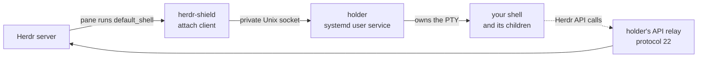

<div align="center">

# herdr-shield

**Herdr plugin that keeps pane shells and coding agents alive across Herdr server crashes, in systemd user services**

[](https://github.com/rezzminator/herdr-shield/actions/workflows/ci.yml)
[](https://github.com/rezzminator/herdr-shield/releases)
[](./LICENSE)
[](#requirements)
[](https://github.com/herdrdev/herdr)

[Install](#install) · [Usage](#usage) · [How it works](#how-it-works) · [What is not protected](#what-is-not-protected) · [Changelog](./CHANGELOG.md)

</div>

When the [Herdr](https://github.com/herdrdev/herdr) server crashes, is killed or restarts, every pane's shell dies with it, and so does the agent, build or REPL running inside. herdr-shield moves each new pane's shell into a holder, a systemd user service that owns the pane's terminal, so the shell outlives Herdr. When Herdr is back, you reattach to the same process, with its memory and screen intact.

```text
# in a protected pane
$ X=kept-in-shell-memory; echo BEFORE-$$-$X
BEFORE-2376013-kept-in-shell-memory

# the Herdr server is killed with SIGKILL and started again;
# herdr-shield list --json still shows the holder, now an orphan:
#   "id": "666c3429c22a5644779ec33ba34aee20", "state": "running", "orphan": true,
#   "cleanup": "herdr-shield kill 666c3429c22a5644779ec33ba34aee20"

# in the restored pane
$ herdr-shield attach 666c3429c22a5644779ec33ba34aee20
BEFORE-2376013-kept-in-shell-memory
$ echo AFTER-$$-$X
AFTER-2376013-kept-in-shell-memory
```

Same PID, same shell variable, same screen: the shell never noticed the crash.

## Why herdr-shield

- **Your process survives, not a copy of it.** Snapshot plugins such as [herdr-resurrect](https://github.com/ntindle/herdr-resurrect) record a layout and start programs again after a crash; herdr-shield keeps the original process running, so nothing is relaunched and nothing in memory is lost.
- **It never kills on a guess.** A holder ends only when Herdr closes that exact pane and herdr-shield authenticates the close. A crash, a missing socket, an EOF or an empty pane list keeps the holder.
- **It tells you what is not protected.** Every pane is reported PROTECTED or UNPROTECTED with the reason, and every orphaned holder comes with its exact cleanup command.
- **It never reruns a command for you.** If a holder is lost, a recovery screen shows the captured command; Enter reruns it only after the original process is proven gone.
- **It fails safe.** Where a holder cannot be verified, herdr-shield prints UNPROTECTED with the reason and opens your configured plain shell.

## Requirements

> [!IMPORTANT]
> herdr-shield runs on **Linux only**, with a running **systemd user manager**: every protected shell lives in a transient systemd user service, and herdr-shield verifies that the service's cgroup sits outside your login session. On macOS, the BSDs and Windows it prints UNPROTECTED and opens your plain shell.

- Herdr 0.9.5, integration protocol 22, the release it is tested against; `herdr-shield doctor` refuses any other protocol.
- Rust through [rustup](https://rustup.rs): `rustup toolchain install` in the checkout installs the toolchain pinned in `rust-toolchain.toml`.
- Two Herdr settings herdr-shield cannot set for you: `shell_mode = "non_login"`, and native agent resume off for the **whole** session (`resume_agents_on_restore = false`), unprotected panes included; otherwise Herdr can type a duplicate command into a shell that is still running.

## Install

Releases are source only. Clone and build:

```sh
git clone https://github.com/rezzminator/herdr-shield.git
cd herdr-shield
rustup toolchain install
cargo build --release --locked
mkdir -p bin
cp target/release/herdr-shield bin/herdr-shield
```

Pick the shell herdr-shield runs inside each holder. It must be a real shell executable, never herdr-shield itself; its arguments decide login and startup behaviour:

```sh
dir="${XDG_CONFIG_HOME:-$HOME/.config}/herdr-shield"
mkdir -p -m 0700 "$dir"
printf '{"shell":"%s","args":[]}\n' "$(command -v bash)" > "$dir/config.json"
chmod 0600 "$dir/config.json"
```

Link the plugin, then print the absolute path Herdr's default shell will use:

```sh
herdr plugin link "$PWD"
herdr plugin list
echo "$PWD/bin/herdr-shield"
```

Edit Herdr's configuration (`${XDG_CONFIG_HOME:-$HOME/.config}/herdr/config.toml`) by hand:

```toml
[terminal]
default_shell = "/absolute/path/to/herdr-shield/bin/herdr-shield"
shell_mode = "non_login"

[session]
resume_agents_on_restore = false
```

Restart the Herdr server so new panes start through herdr-shield, then check:

```sh
herdr-shield doctor
herdr-shield list --json
```

`doctor` prints a line starting `OK: Linux/systemd user manager` when everything is in place. Panes that were already running are not adopted: end their work deliberately and open new panes. Neither the build nor herdr-shield changes your Herdr or systemd configuration by itself.

## Usage

Run in a protected pane, or in any terminal with access to the same Herdr server:

| Command | What it does |
| --- | --- |
| `herdr-shield attach <holder-id>` | Reconnect a living holder and redraw its screen. One attachment owns input at a time; a second one is refused. |
| `herdr-shield list --json` | Every pane with PROTECTED or UNPROTECTED and the reason, the coverage of each pane launch route, every holder, and each orphan's cleanup command. A failed enumeration prints ERROR, never an empty list. |
| `herdr-shield doctor` | Check the platform, the systemd user manager, the configuration, native resume being off, Herdr's protocol and the holder registry. Changes nothing. |
| `herdr-shield kill <holder-id>` | End one exact holder after you type its full ID. Scripts pass `--confirm <the-same-id>`; piped input is never consent. |
| `herdr-shield reconcile` | Re-run the coverage check Herdr runs at plugin startup. Never treats a missing pane as a close. |
| `herdr-shield --help` | The full command list. |

From Herdr, the plugin's `list` action records the same report in the plugin log:

```sh
herdr plugin action invoke list --plugin herdr-shield
herdr plugin log list --plugin herdr-shield
```

### After a Herdr crash or restart

1. Holders keep running. On a cold restart, Herdr's restored panes cannot prove which old process they belong to, so each holder is kept as an orphan and the restored pane opens a plain shell marked UNPROTECTED.
2. `herdr-shield list --json` shows each orphan's `id`.
3. In the pane where you want it, run `herdr-shield attach <id>`.

A Herdr live handoff (`server.live_handoff`) rebinds holders automatically, as long as the original attachment and Herdr's reported shell process both still match.

## How it works



- The holder runs as `herdr-shield-{holder-id}.service` under your systemd user manager, outside Herdr's process tree and your login session scope, so the Herdr server can die without taking it along.
- The holder keeps its own terminal model (Alacritty's). It answers every terminal query, even with no client attached, and sends a full redraw on reattach. Scrollback stays bounded and in memory.
- Programs in the shell reach Herdr's API through the holder's relay, which knows each of protocol 22's 102 methods: it refuses server administration, plugin installation, binary transport and untyped `agent.explain` visibly, passes native errors through unchanged, and maps pane, tab and workspace IDs to the current binding.
- Configuration, holder records and sockets are private to your user (directories 0700, files 0600). Your environment is passed to the holder in memory and never written to disk or logs.

<details>
<summary>Terminal feature support</summary>

| Feature | Behaviour |
| --- | --- |
| CR/LF, erase/insert, Unicode/wide/combining, scrolling, alternate screen | Alacritty model; fixed cell and redraw tests |
| SGR default/indexed/truecolor, cursor, app cursor/keypad, paste/mouse/focus modes | Rendered and restored on reattach; mouse protocol bytes are tested, physical mouse hardware is not |
| Device attribute, status, colour and size queries, even split across reads | Answered once, by the holder; never replayed to Herdr |
| Clipboard (OSC 52) | Reads never forwarded; a valid base64 write of at most 64 KiB, made while a client is attached, reaches Herdr, whose own policy applies; a write made while detached is never replayed |
| Unknown or private OSC/DCS | Ignored by the model; never forwarded raw |
| Working directory (OSC 7), prompt marks (OSC 133), title | Bounded and audited; a reattach restores the latest directory and title, never past commands |
| Hyperlinks (OSC 8), underline styles and colours | Rendered by the model; fixed protocol tests |
| Colour probes from the attaching terminal | Validated replies merge with the retained or default palette |

Typed input and terminal query replies use separate bounded queues: a program that stops reading its input cannot make the holder hang or grow without bound; the holder keeps draining output and shows `terminal.query_error` in `list`. When no program has set a cursor shape, your terminal's default cursor is restored.

</details>

## What is not protected

- **Panes not started through `terminal.default_shell`:** layouts with an explicit command, plugin panes, custom commands, popups, replacements outside the default-shell route, and panes already running at installation. They are reported UNPROTECTED, with the reason. A read-only census also lists terminals Herdr does not show as panes, such as popups and overlays.
- **Logout, a stop of the systemd user manager, reboot.** These end holders. herdr-shield does not enable linger or touch system services.
- **Automatic rebinding after a cold restart.** Stock Herdr has no durable pane identity across a restart; reattach deliberately with `herdr-shield attach <id>`. Protecting every pane, and rebinding automatically, need an upstream Herdr facility, drafted in [docs/upstream-issue.md](./docs/upstream-issue.md).
- **A hostile process running as your user.** Private sockets and capabilities prevent accidental cross-binding; they are not a sandbox.

Native agent discovery in Herdr sees the attach client, not the process inside the holder; native `agent.start` busy states and errors stay visible.

## Upgrade and uninstall

Each holder keeps running the executable it started from, so install each version in its own directory and keep an old one while its holders live; never kill holders just to upgrade. A newer client attaches to an older compatible holder; an incompatible major version prints the path of the compatible client.

To uninstall, restore your previous `terminal.default_shell`, run `herdr plugin unlink herdr-shield`, and leave running holders alone: attach to each with its old executable, or end it with `herdr-shield kill <holder-id>`. Unlinking does not adopt, resume or end any workload.

## Verification

`make check` runs the whole gate in one throwaway root under `/tmp` that holds `HOME`, every XDG directory, `TMPDIR`, `CARGO_HOME` and `CARGO_TARGET_DIR`:

```sh
make check
```

It downloads the Herdr release pinned in `pins.env`, verifies its SHA-256, and runs `cargo fmt`, `cargo clippy -D warnings`, a release build, `cargo test --all-targets --all-features`, the structural checks and the real-Herdr tests. It needs Linux on x86_64, a running systemd user manager, rustup, curl and `/usr/bin/python3`. The tests start their own Herdr servers on owned sockets, use only `herdr-shield-test-` services and dummy workloads, and clean up even on failure. On success the root is removed; on failure its path is printed. A missing tool or a skipped test fails the run. CI runs `make check` on `ubuntu-latest` only: holders are systemd user services, so there is no macOS leg.

`make release` checks that `Cargo.toml`, `herdr-plugin.toml`, the `CHANGELOG.md` section and `releases/v{version}.md` agree on the version, and that its tag does not exist yet.

The acceptance contract behind these tests, with every promise numbered, is [docs/spec.md](./docs/spec.md). Non-Linux behaviour is tested by simulating the unsupported entry point; no non-Linux host was run.

## Help and contributing

- Questions and bugs: [SUPPORT.md](./SUPPORT.md) and the [issue templates](https://github.com/rezzminator/herdr-shield/issues/new/choose).
- Security problems: [SECURITY.md](./SECURITY.md), never a public issue.
- Changes: [CONTRIBUTING.md](./CONTRIBUTING.md); a place to start is a [good first issue](https://github.com/rezzminator/herdr-shield/issues?q=is%3Aissue+is%3Aopen+label%3A%22good+first+issue%22).

## License

[MIT](./LICENSE). The vendored Herdr protocol schemas are Apache-2.0; see [LICENSE-HERDR](./LICENSE-HERDR).
